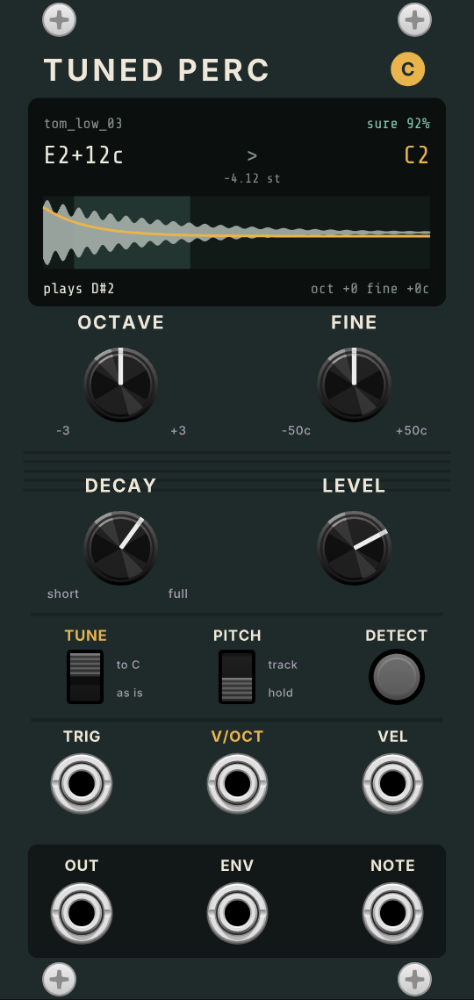

# Tuned Perc

A VCV Rack 2 module that plays one percussion sample in key. When you load a
sample, Tuned Perc listens to it, works out its pitch, and shifts it to the
nearest C. **V/OCT** then plays it like an oscillator: 0 V is the drum's own C,
+1 V is an octave up, and +7/12 V is a fifth up. A tom, 808, rim or bell can
follow the same sequence as your bass or chords.

## Getting started

1. Right-click and choose **Load sample...**, or drag a WAV or AIFF from Finder
   onto the module.
2. The screen shows the detected note (for example `E2+12c`), how sure it is,
   and the C it has been moved to (`C2`, `-4.12 st`).
3. Patch a trigger into **TRIG**, a sequencer's pitch into **V/OCT**, and
   **OUT** to your mixer.

## Controls

| Control | What it does |
|---|---|
| **OCTAVE** | -3 to +3 octaves |
| **FINE** | -50 to +50 cents |
| **DECAY** | 10 ms to 4 s. Fully CW plays the whole sample |
| **LEVEL** | Silent to +6 dB. The default (about 2 o'clock) is 0 dB |
| **TUNE** | **to C**: use the detected pitch. **as is**: play the sample as recorded, so you can compare. V/OCT works either way |
| **PITCH** | **hold**: V/OCT is read when each hit starts, like a drum machine. **track**: the hit follows V/OCT while it plays, for glides and bends |
| **DETECT** | Listen to the sample again (lit while working). Use it after changing **Listen to** in the menu |

## Jacks

| Jack | |
|---|---|
| **TRIG** | Each rising edge plays the sample from the start. A new hit fades the last one out in 3 ms |
| **V/OCT** | 1 V per octave. 0 V = the drum's own C |
| **VEL** | 0-10 V scales the level. Unpatched = full |
| **OUT** | Audio, 5 V peak. Stereo files are mixed to mono |
| **ENV** | The hit's envelope, 0-10 V, for sidechain ducking or a filter |
| **NOTE** | The note actually playing, as standard V/OCT (0 V = C4). Patch it into an oscillator to tune a synth to the drum |

## The screen

- **Top line**: the file name and how sure the detector is. Below 40% it is
  red, and the sample plays as recorded ("no clear pitch").
- **Big line**: the detected note and cents, then the C it is moved to and by
  how many semitones.
- **Waveform**: the teal band is the part the detector listened to (the click
  at the very start of the attack is skipped). The yellow line is the pitch over time
  (+-1 octave fills the height), so an 808 glide shows as a falling line.
- **Bottom line**: the note playing now, and the OCTAVE and FINE settings.

## How the pitch is found

Most drums don't repeat their waveform exactly: a tom, bottle, can or tabla
rings at a few resonances that aren't whole-number multiples of each other,
and the sound bends and fades while it rings. So since version 2.2 the
detector listens to the spectrum instead:

1. It skips the click of the attack and cuts the rest into overlapping frames
   (up to 190 ms long, so even a 30 Hz kick is placed to a few cents; shorter
   for sounds that only ring briefly).
2. In each frame it finds the **resonances**: sharp peaks that stand well
   above the noise around them. A frame counts as pitched when most of its
   energy sits in resonances.
3. The frame's note is the **strongest resonance**, or the fundamental of a
   harmonic series when the peaks form one: a bright saw lands on its root,
   and a bass hit whose fundamental is weak or missing (only the 2nd, 3rd,
   5th... harmonics) still gets the right note.
4. The answer is a loudness-weighted median of the pitched frames. How sure
   it is depends on how much of the sound is pitched and how well the frames
   agree.
5. If that finds nothing, the older waveform-repeat method (YIN) gets a second
   try, which suits very short synth blips.

On a test set of 415 real drum samples this tunes 309, up from 263 in
version 2.1, while hats, claps and stomps are still left alone.

**Listen to** in the right-click menu chooses which part counts:

- **Settled pitch** (default): ignores the first quarter of the pitched part,
  where an 808 or a tom is still gliding down. This is usually what you hear
  as the drum's note.
- **The whole hit**: everything with a clear pitch.
- **The attack**: the start of the pitched part, for drums whose note you
  hear mostly at the top of the glide.

Noisy sounds (hats, snares, claps) don't have one clear pitch, so they're left
alone. The shift is never more than 6 semitones, so the character of the
drum changes as little as possible.

## Right-click menu

- **Load sample...** and drag and drop: WAV or AIFF, 8/16/24/32-bit or float,
  any sample rate, up to 20 seconds.
- **Next / Previous sample in folder** to audition a folder quickly.
- **Listen to**: see above.

The sample's path is saved with the patch, and the pitch is detected again
when the patch opens.

## Building

GitHub Actions tests the detector and engine and builds the Apple Silicon
version on every push to main (see `.github/workflows/build.yml`). The
`.vcvplugin` file appears on this repository's **latest** release page. To
build locally, download the Rack SDK and run
`make dist RACK_DIR=/path/to/Rack-SDK`.

- `src/PercEngine.hpp`: pitch detection and playback, with no Rack code.
- `src/SampleFile.hpp`: WAV and AIFF reading.
- `test/engine_test.cpp`: `c++ -std=c++11 -O2 -o test/engine_test test/engine_test.cpp && test/engine_test`
- `res/make_panel.py` draws the panel; `tools/preview.py` renders `panel-preview.png`.
